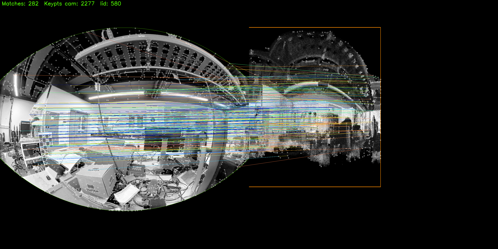

# lidar_camera_calibration

Target-less LiDAR-camera extrinsic calibration for any LiDAR / camera pair, as a wrapper around
[koide3/direct_visual_lidar_calibration](https://github.com/koide3/direct_visual_lidar_calibration) running in its
Docker image. This repository holds only scripts, a sensor config and one worked example;
the toolbox and SuperGlue are **not** included (see [Licences](#licences)).



## Tested environment

| | |
|---|---|
| recording PC | Ubuntu 22.04, ROS 2 Humble |
| calibration PC | Ubuntu 24.04, Docker 29.9, NVIDIA GPU with nvidia-container-toolkit, X11 display |
| toolbox image | `koide3/direct_visual_lidar_calibration:humble` (Ubuntu 22.04, ROS 2 Humble) |

The image tag follows the bags: ROS 2 bags use `humble` or `jazzy`, ROS 1 bags use `noetic`.
The scripts switch on `$ROS_VERSION`; only the Humble path has been run.

## 1. Describe the rig

Copy `config/template.env` and fill it in. The camera intrinsics must be calibrated beforehand.

| key | meaning |
|---|---|
| `IMAGE_TOPIC`, `POINTS_TOPIC`, `INFO_TOPIC` | `Image`, `PointCloud2` and (optional) `CameraInfo` topics |
| `LIDAR_TYPE` | `spinning` (Ouster, Velodyne, Hesai ...): `preprocess` runs with `--dynamic_lidar_integration`. `non_repetitive` (Livox ...): static accumulation, no flag |
| `CAMERA_MODEL` | `auto` (read from `CameraInfo`, `plumb_bob` / `fisheye` only), `plumb_bob`, `fisheye`, `atan`, `omnidir`, `equirectangular` |
| `CAMERA_INTRINSICS`, `CAMERA_DISTORTION` | `fx,fy,cx,cy(,xi)` and `k1,k2,p1,p2(,k3)`; required unless the model is `auto` |
| `INITIAL_GUESS` | `superglue` (automatic) or `manual` (pick point pairs in a GUI, no SuperGlue needed) |
| others | optional overrides of the toolbox defaults (voxel resolution, SuperGlue weights, RANSAC thresholds) |

## 2. Record bags

```
source /opt/ros/<distro>/setup.bash
scripts/record_calib_bags.sh my_rig.env <bag_dir> calib_01 [duration_s]
```

- `spinning`: start at rest, then tilt the rig slowly up and down for about 10 s (20-30 s for 16 / 32 beams).
- `non_repetitive`: keep the rig still for 10-15 s.
- One bag is enough, 5-10 from different places give a better result. Use a scene with texture and structure.

## 3. Calibrate

```
scripts/run_calibration_container.sh my_rig.env <bag_dir> <result_dir> [humble|jazzy|noetic]
# inside the container
/tmp/calib_repo/scripts/calibrate_in_container.sh          # or one step: setup | preprocess | guess | calibrate | viewer
```

`setup` installs PyTorch and clones SuperGlue (skipped for `INITIAL_GUESS=manual`), `preprocess` builds the dense
cloud and intensity image of each bag, `guess` gives the initial transform, `calibrate` refines it, `viewer` shows the
cloud coloured by the image. `HEADLESS=1` opens no windows (`calibrate` still needs an X display, Xvfb is enough).

Result: `<result_dir>/calib.json`, `T_lidar_camera = [x y z qx qy qz qw]`, the camera pose in the lidar frame.

## 4. Camera pose in the robot body frame (optional)

```
scripts/calib_to_body_extrinsic.py <result_dir>/calib.json --body_to_lidar X Y Z [--lidar_yaw_deg YAW]
```

## Example: Ouster OS-1-128 + Insta360 X4

Files in `example/ouster_os1_insta360_x4/`, config `example/ouster_os1_insta360_x4/rig.env`.
Step-by-step commands and parameters: [example/ouster_os1_insta360_x4/README.md](example/ouster_os1_insta360_x4/README.md).

Sensor drivers are NOT included in this repo.

| | |
|---|---|
| lidar | Ouster OS-1-128, firmware 3.0.1, 1024x10, ROS 2 driver: `LIDAR_TYPE=spinning` |
| camera | Insta360 X4 front fisheye, 1440x1440: `CAMERA_MODEL=omnidir`, intrinsics in `front_omnidir_intrinsics.json` |
| non-default | `VOXEL_RESOLUTION=0.008` (range quantisation of the driver's cloud), indoor SuperGlue weights |

Results: 

| session | bags | `T_lidar_camera` translation (m) |
|---|---|---|
| `2026-04-05_lab_front` | 3 x 30 s | -0.030, 0.018, 0.130 |
| `2026-04-08_mount_v1_front` | 4 | -0.036, 0.008, 0.154 |
| `2026-06-03_mount_v2_front` | 3 | 0.006, 0.070, 0.134 |


## Licences

| component | licence | shipped here |
|---|---|---|
| this repository | MIT (`LICENSE`) | yes |
| koide3/direct_visual_lidar_calibration | MIT | no, pulled as a Docker image |
| magicleap/SuperGluePretrainedNetwork | academic / non-commercial research only | no, cloned by `setup`; use `INITIAL_GUESS=manual` to avoid it |
